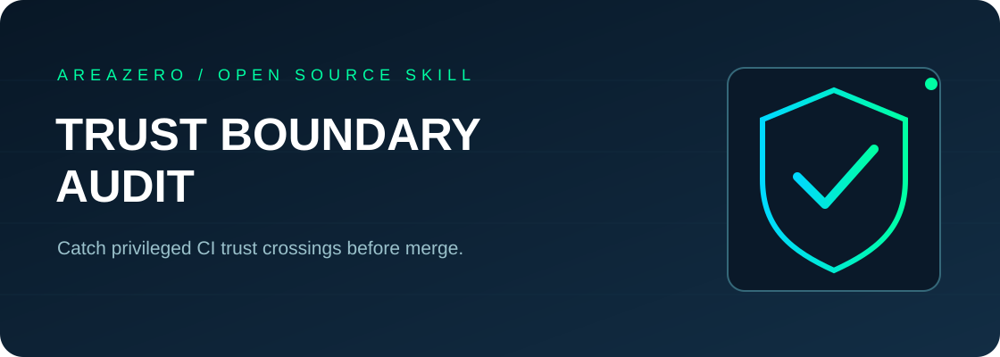

<p align="center"></p>
<p align="center"></p>

# GHA Trust Boundary Audit

**Trust boundaries are where CI failures become security incidents.** This portable Agent Skill gives Claude Code, Codex and human maintainers a **read-only, line-referenced first pass** over GitHub Actions workflows, with exact causes and manual remediation paths. It never executes target CI, reads secrets, calls a cloud model, or accesses the network.

[](https://github.com/Kanompung1988/gha-trust-boundary-audit/actions/workflows/ci.yml) · [Agent Skills specification](https://agentskills.io/specification) · [Rules](references/RULES.md) · [MIT License](LICENSE)

## Why it exists
GitHub warns that `pull_request_target` uses a privileged context, that untrusted metadata injected into shell commands can be unsafe, and that token permissions should be minimized. This utility focuses on the source-to-execution trust boundary rather than producing 100 noisy, generic YAML lint recommendations.

## Quickstart

```bash
git clone https://github.com/Kanompung1988/gha-trust-boundary-audit.git
cd gha-trust-boundary-audit
python -m pip install -r requirements.txt
python scripts/audit.py examples/unsafe.yml --format markdown --fail-on high
# exits 2 because example contains high and critical findings
python scripts/audit.py /path/to/your/repository --format json --fail-on high
```

### Install as an Agent Skill

```bash
# Claude Code, within your working repository
mkdir -p .claude/skills
git clone --depth 1 https://github.com/Kanompung1988/gha-trust-boundary-audit.git .claude/skills/gha-trust-boundary-audit
# Codex, within your working repository
mkdir -p .agents/skills
git clone --depth 1 https://github.com/Kanompung1988/gha-trust-boundary-audit.git .agents/skills/gha-trust-boundary-audit
```

Typical prompt: *"Audit .github/workflows before merging, report actionable risk with line numbers and confidence limits."*

## Detects
Direct interpolation of untrusted issue/PR fields into shell scripts; unsafe PR-head checkout followed by shell under `pull_request_target`; globally writable tokens; unpinned action references; checkout token persistence with writable token scopes; direct secret interpolation. Every finding includes a rule identifier, severity and **YAML location**.

## Evidence example

```text
HIGH GHA002 unsafe.yml:3 — Workflow grants all token permissions write access
HIGH GHA004 unsafe.yml:12 — Untrusted event text interpolated directly into a shell script
CRITICAL GHA006 unsafe.yml:12 — Shell executes after checking out PR-controlled content under pull_request_target
```

These outputs are from synthetic fixture patterns; the exact number and ordering of all findings can change as rules evolve. Run the command above for authoritative current output.

## Architecture & QA
- `scripts/audit.py` — size-bounded, deterministic YAML traversal; preserves GitHub `on` event key; CLI produces JSON or Markdown.
- `tests/test_audit.py` — Python unittest cases covering vulnerable and safer patterns, parser edge cases, real CLI exit codes, repository traversal and symbolic link rejection.
- `examples/safe.yml`, `examples/unsafe.yml` — synthetic demonstrations. No real tokens or third-party repository scans.
- `.github/workflows/ci.yml` — verifies unit tests and a CLI fixture on Python 3.10 and 3.12.

Run `python -m unittest discover -s tests -v` and `python scripts/audit.py examples/unsafe.yml --format json --fail-on none`.

## Limitations & safety
**Static heuristics only** — no semantic evaluation of GitHub expressions, cross-workflow artifact provenance, actual GitHub settings, private repository permission defaults, or shell interpretation. Warnings are not proof of exploitable vulnerabilities; clean output is not proof of security. The tool rejects oversized files and YAML duplicate keys. Keep credentials out of input data and do not run suggested remediations without review.

## Contributing & attribution
Open an Issue with a minimal synthetic YAML case, expected rule, and GitHub Docs link. Include tests for both false positives and true positives before PRs. Authored for AREAZERO Skill Lab. Source/docs under MIT (see LICENSE); the official Area Zero logo in `assets/area-zero-logo-full.svg` is retained from the owner's brand repository and **is not covered by this code's MIT license**.
